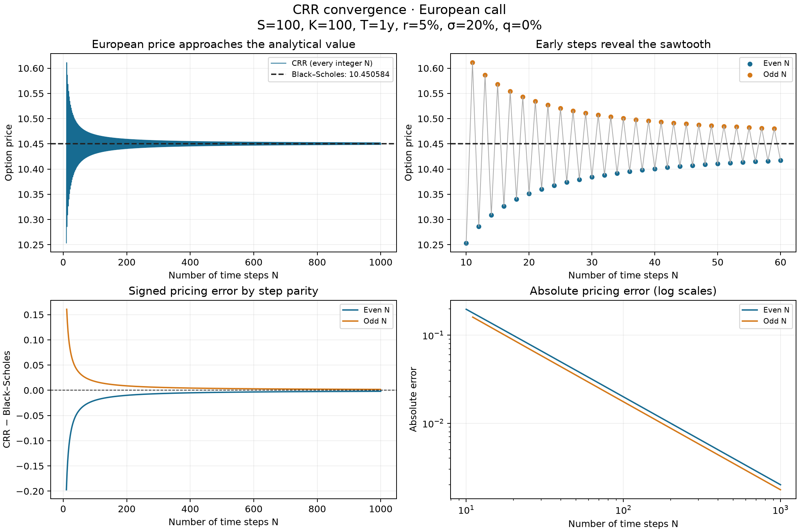
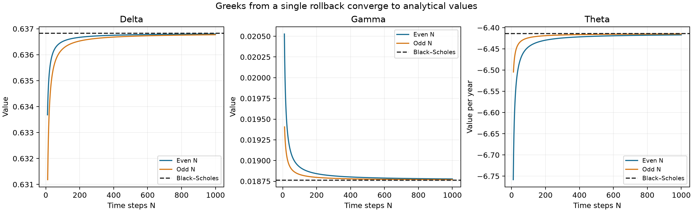

> **Result.** For an at-the-money European call ($S=K=100$, $T=1$, $r=5\%$, $\sigma=20\%$), the tree price converges to the Black–Scholes value of 10.4506 with absolute error falling roughly as $1/N$, reaching 0.0020 at $N=1{,}000$. Convergence is not monotone: odd step counts overprice and even step counts underprice, so the error traces a sawtooth. Delta, gamma and theta read from the same single rollback converge to their analytical values too.

## Background

This project rebuilds the scope of two tutorials on binomial pricing: vanilla European options and barrier options. My original implementation was lost, so this is a reconstruction from the tutorial material, written from scratch. It goes further than the originals with volatility-based tree calibration, working call **and** put payoffs, Greeks from a single valuation, independent numerical checks, and reproducible analysis.

The tutorials used fixed up and down factors ($u=1.1$, $d=1/u$). Holding those fixed while changing $N$ silently changes the implied annual volatility, so it cannot support a fair convergence study. Here the factors are recalculated for every $N$ with volatility held constant.

## Tree construction

With $\Delta t = T/N$ and dividend yield $q$, the Cox–Ross–Rubinstein parameters are

$$
u = e^{\sigma\sqrt{\Delta t}},\qquad
d = \frac{1}{u},\qquad
p = \frac{e^{(r-q)\Delta t}-d}{u-d}.
$$

Terminal payoffs are $\max(S-K,0)$ for calls and $\max(K-S,0)$ for puts, and values roll back under the risk-neutral probability $p$:

$$
V_{i,j} = e^{-r\Delta t}\left[(1-p)\,V_{i+1,j} + p\,V_{i+1,j+1}\right].
$$

Both implementations do $O(N^2)$ work with $O(N)$ memory. The NumPy version replaces the inner Python loop with whole-layer array operations. It doesn't change the complexity, but it is much faster once trees get large:

| Contract | N | Loop (ms) | NumPy (ms) | Speedup |
| --- | ---: | ---: | ---: | ---: |
| European | 100 | 0.17 | 0.10 | 1.6× |
| European | 1,000 | 17.65 | 1.23 | **14.3×** |
| Up-and-out | 100 | 0.56 | 0.83 | 0.7× |
| Up-and-out | 1,000 | 63.27 | 10.77 | **5.9×** |

For small trees, NumPy's per-call overhead outweighs the saving, so the loop version wins.

## Convergence of the price

The benchmark prices the call at **every integer N from 10 to 1,000** (991 valuations). Sampling only multiples of 10 would hide the odd/even oscillation.

- **Sawtooth (top right).** Odd and even step counts bracket the analytical price from opposite sides.
- **Signed error (bottom left).** Each parity approaches zero smoothly from its own side, even though the combined sequence jumps back and forth.
- **Log–log error (bottom right).** Both parities lie on straight lines with slope close to $-1$: ten times as many steps gives roughly ten times less error.

## Greeks from a single rollback

Instead of repricing with bumped inputs, the Greeks are read from the tree's first two levels during the same valuation. With level-one values $V_d, V_u$ and level-two values $V_{dd}, V_{ud}, V_{uu}$ at matching stock prices:

$$
\Delta\approx\frac{V_u-V_d}{S_u-S_d},\qquad
\Gamma\approx
\frac{\dfrac{V_{uu}-V_{ud}}{S_{uu}-S_{ud}}-\dfrac{V_{ud}-V_{dd}}{S_{ud}-S_{dd}}}
{(S_{uu}-S_{dd})/2},\qquad
\Theta\approx\frac{V_{ud}-V_0}{2\Delta t}.
$$

Because $ud=1$ in CRR, $S_{ud}=S_0$, so theta compares two dates at the same stock price. A test checks that a valuation performs exactly one rollback.

| Quantity | Tree at N = 1,000 | Black–Scholes |
| --- | ---: | ---: |
| Price | 10.44858 | 10.45058 |
| Delta | 0.63680 | 0.63683 |
| Gamma | 0.018778 | 0.018762 |
| Theta (per year) | −6.4171 | −6.4140 |

These are finite-grid estimates rather than exact derivatives. Gamma and theta are noticeably biased on coarse trees, and odd and even $N$ converge at different speeds.

## Barrier options

The barrier pricer handles a European **up-and-out** option with zero rebate, monitored at every tree date. Any node with $S \ge H$ is set to zero during rollback, so a path that has touched the barrier is worth nothing even if it finishes below it. This is discrete monitoring: changing $N$ changes the monitoring schedule as well as the lattice, so barrier prices can move irregularly with $N$ and are not comparable to vanilla Black–Scholes. When the barrier is out of reach of every node, the pricer recovers the vanilla tree price.

## Validation

The pytest suite checks analytical reference values, Greek convergence, put–call parity, agreement between the loop and NumPy trees, two-step edge cases, invalid inputs, barrier touch and limit behaviour, and barrier prices against an independent enumeration of every complete path. GitHub Actions runs the tests and the full convergence benchmark on Python 3.10 and 3.13. Three worked notebooks cover European options, barrier options, and Greeks and convergence.

## Takeaways

1. **CRR converges, but not smoothly.** A single step count can be off in either direction, so parity matters as much as the size of $N$.
2. **Error is $O(1/N)$.** Each extra decimal place of accuracy costs about ten times the steps, and the $O(N^2)$ rollback makes that expensive, which is where vectorisation pays off.
3. **Greeks come almost for free.** Two levels of the tree already hold enough information for delta, gamma and theta, with no extra valuations.

## Limitations and extensions

The model assumes constant rates, dividend yield and volatility. American exercise, knock-in and down barriers, rebates, continuous-monitoring corrections and alternative tree parameterisations are outside the current scope. Odd–even averaging or Richardson extrapolation could speed up convergence.
