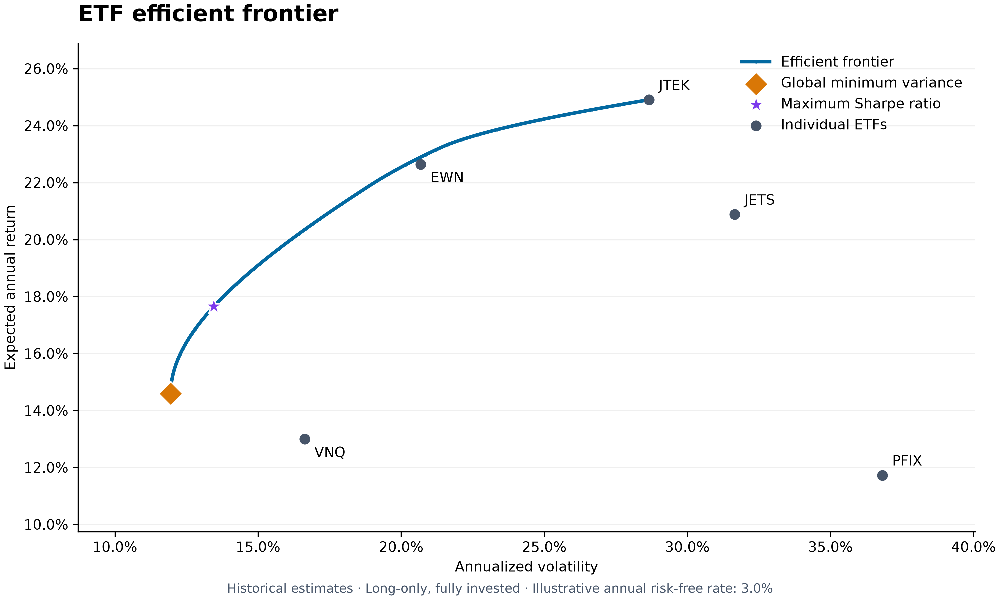
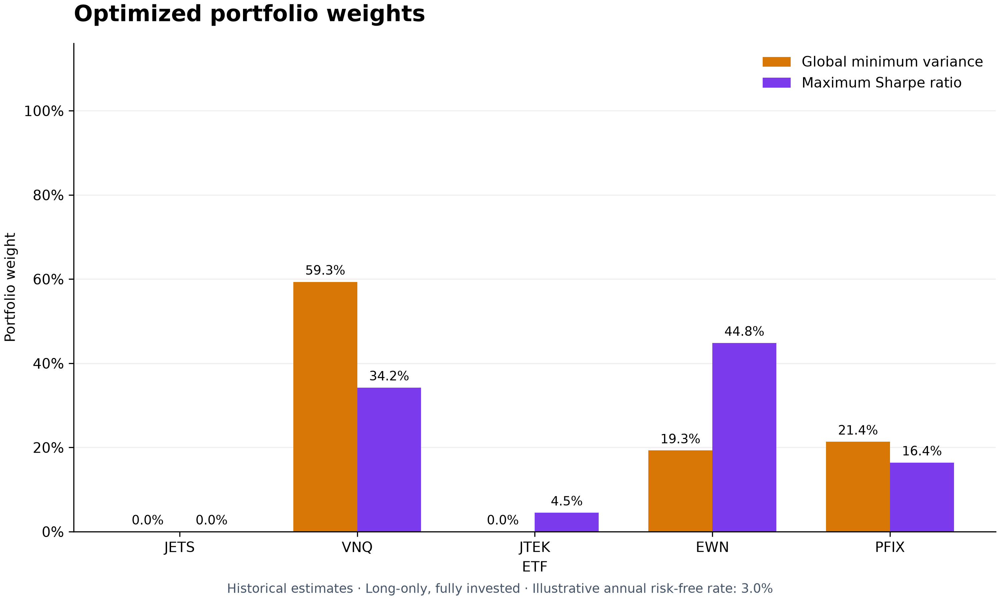
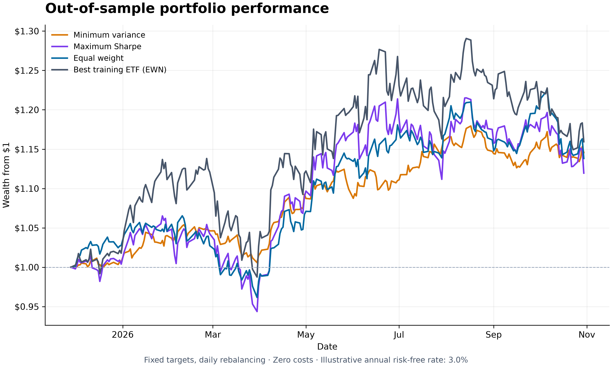
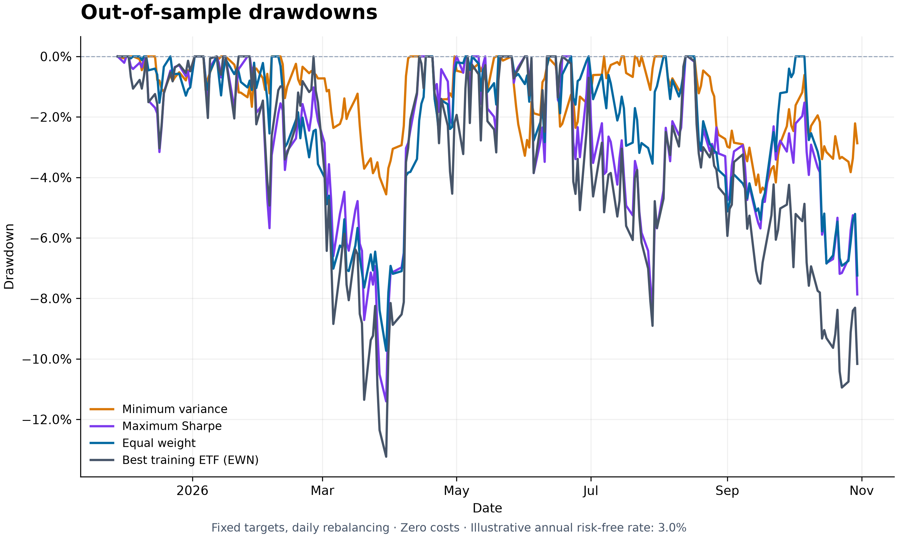

> **Result.** On a 231-day holdout, the minimum-variance portfolio delivered the best risk-adjusted return (Sharpe 1.32, max drawdown −4.6%). The portfolio that was *optimal* in-sample, maximum Sharpe, came last on Sharpe (0.59), behind even equal weighting. Expected-return estimates are the weak link.

## Question

Mean–variance optimisation is only as good as its inputs. Sample means are notoriously noisy, while covariance is estimated more reliably. I wanted to measure how much that matters in practice: estimate everything on a training window, freeze the weights, and evaluate them on data the optimiser never saw.

## Data

Daily adjusted closing prices (splits and distributions reflected) from Yahoo Finance for five USD-listed ETFs chosen to span different risk exposures:

| Ticker | Exposure |
| --- | --- |
| JETS | Airlines |
| VNQ | U.S. real estate |
| JTEK | U.S. technology leaders |
| EWN | Dutch equities |
| PFIX | Hedge against rising long-term rates |

Only dates with prices for every ETF are kept; nothing is forward-filled. The saved snapshot has 771 common observations (5 Oct 2023 – 30 Oct 2026), giving 770 daily returns.

## Method

Daily simple returns, annualised means and sample covariance:

$$
R_{i,t}=\frac{P_{i,t}}{P_{i,t-1}}-1,\qquad
\mu=252\,\overline{R},\qquad
\Sigma=252\,\operatorname{Cov}(R).
$$

Three long-only, fully invested portfolios ($\sum_i w_i = 1$, $0 \le w_i \le 1$) are solved with SciPy's SLSQP:

- **Global minimum variance:** $\min_w \; w^\top \Sigma w$
- **Maximum Sharpe:** $\max_w \; (w^\top\mu - r_f)/\sqrt{w^\top \Sigma w}$, using deterministic restarts because SLSQP is a local solver
- **Efficient frontier:** minimum variance at 60 target returns

Every solution is checked for solver success, bounds, budget and target constraints before it is accepted. The risk-free rate is an illustrative 3% a year.

## Out-of-sample backtest

The sample is split chronologically (70/30, no shuffling): training from 6 Oct 2023 to 28 Nov 2025 (539 returns) and testing from 1 Dec 2025 to 30 Oct 2026 (231 returns). Four strategies are fixed using **training data only**: minimum variance, maximum Sharpe, equal weight, and the single ETF with the best training Sharpe (EWN). There is no re-optimisation during the test period.

| Strategy | Total return | CAGR | Volatility | Sharpe | Max drawdown |
| --- | ---: | ---: | ---: | ---: | ---: |
| **Minimum variance** | 14.56% | 15.98% | 9.31% | **1.32** | **−4.56%** |
| Maximum Sharpe | 11.95% | 13.11% | 18.72% | 0.59 | −11.41% |
| Equal weight | 13.81% | 15.16% | 14.34% | 0.85 | −9.73% |
| Best training ETF (EWN) | **15.94%** | **17.51%** | 23.11% | 0.69 | −13.24% |

## Takeaways

1. **Estimation error dominates.** Maximum Sharpe leans hardest on expected-return estimates, and it had the worst out-of-sample Sharpe of the four strategies.
2. **Covariance-only allocation was the most robust.** Minimum variance ignores expected returns entirely, yet it cut volatility by about a third relative to equal weighting while earning a slightly higher return.
3. **The highest return is not the best risk-adjusted result.** EWN had the best total return but 2.5× the volatility of minimum variance and nearly three times its drawdown.

## Limitations

- A single holdout period with five pre-selected ETFs cannot establish statistical significance.
- The backtest assumes idealised daily rebalancing with no transaction costs, slippage or taxes.
- PFIX holds derivatives, so long-only ETF weights do not remove its nonlinear exposures.

## Next steps

Walk-forward evaluation with periodic re-estimation, shrinkage covariance (Ledoit–Wolf), transaction-cost-aware rebalancing, and bootstrap confidence intervals for the Sharpe ratio differences.
